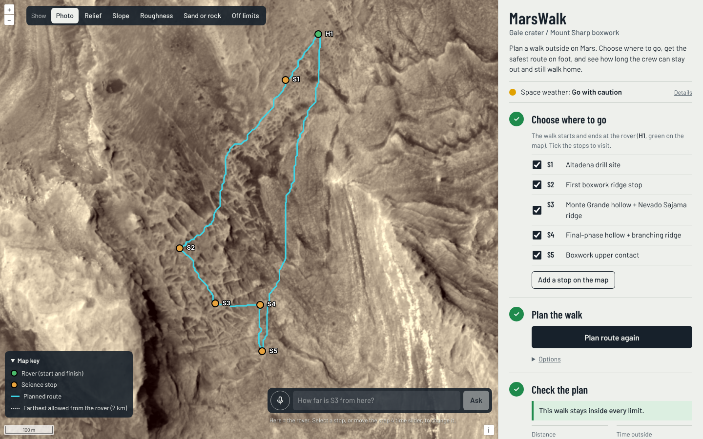
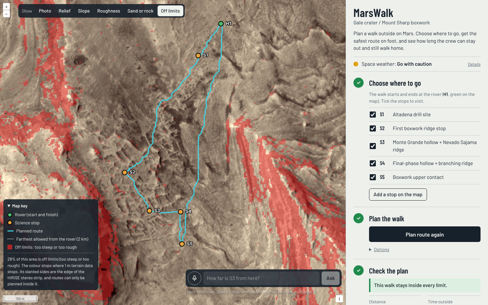
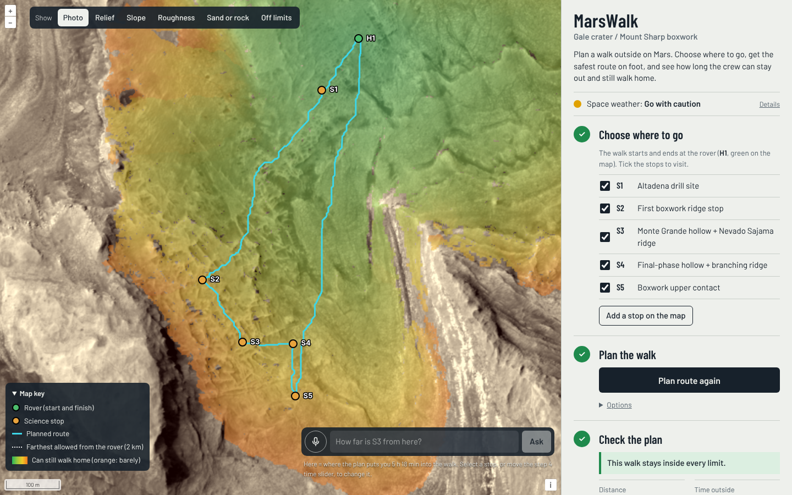
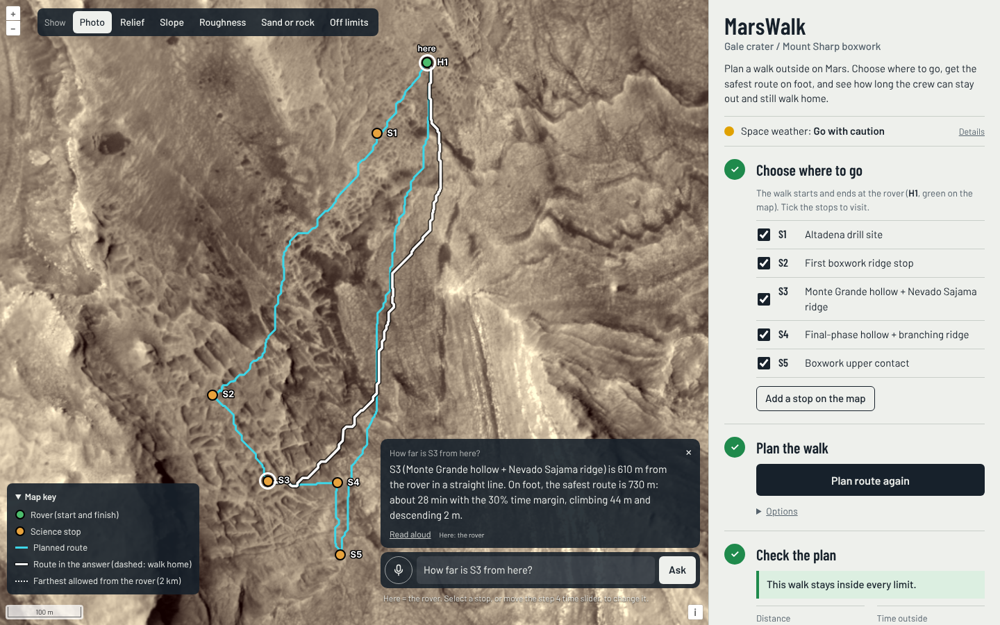
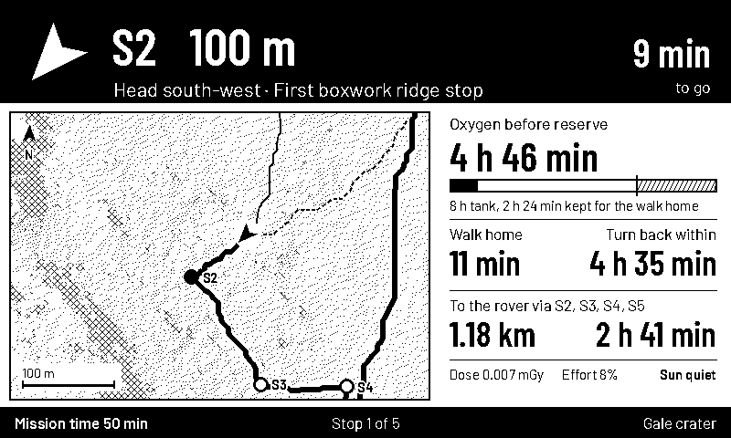
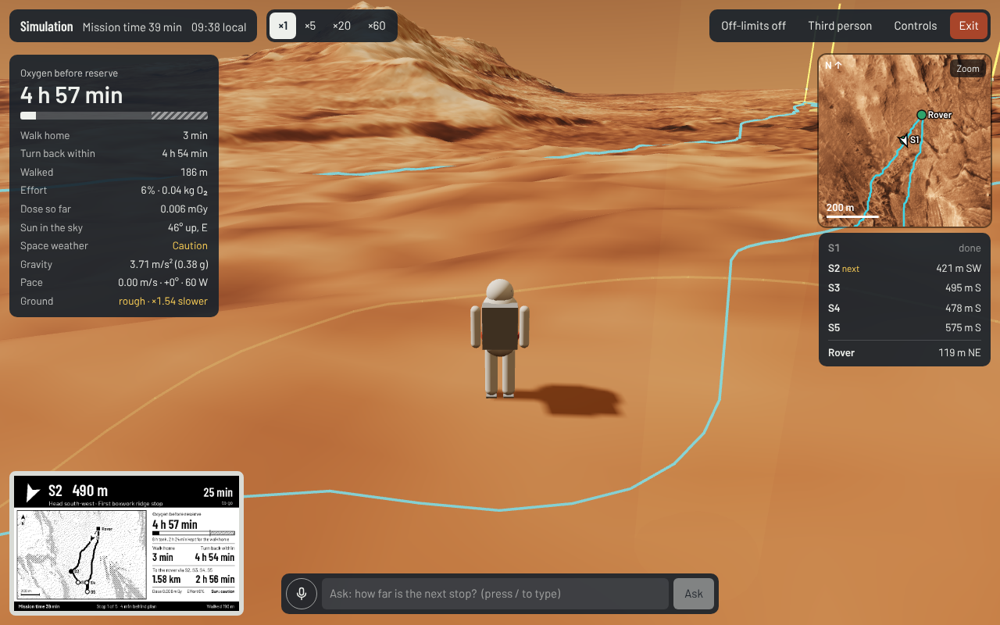

# MarsWalk

**Plan a walk on Mars that always leaves enough oxygen to get home.**



---

## The walk home is the whole problem

Picture the first crew to step out at Gale crater. The rover is parked at the foot of Mount Sharp. Ahead, a maze
of boxwork ridges that Curiosity spent 2025 driving through: veins of rock left standing where the ground around
them eroded away. Five places worth a geologist's afternoon. Each suit carries eight hours of oxygen.

The obvious question is *how do we get there?* The real one is quieter: **from any point on this walk, can we still
make it back?**

On Earth, a hiker who misjudges a trail is tired. On Mars, a crew member who misjudges the walk back is out of air.
So MarsWalk doesn't just draw a route. It keeps asking, for every metre of the walk and every minute of the day,
whether the crew can still turn around and reach the rover with the reserve untouched. Then it shows the answer on
the map, says it out loud, and puts it on the crew member's sleeve.

This is our entry to the **NASA Space Apps Challenge 2026** (*Marswalk* mapping challenge), by Jih Bin Luo Liu and
Justin Meng.

## What it does, in one walk

**1. It reads the ground the way a boot would.** From NASA's 1-metre HiRISE stereo terrain it measures slope at the
scale of one stride and of a few strides, roughness (rocks and ledges), and loose sand (from THEMIS thermal inertia).
Anything too steep or too rough is off-limits: 28 % of the HiRISE window around the rover.



**2. It finds the cheapest walk, in oxygen, not metres.** The route search runs over every metre of the grid,
pricing each step with the walking-energy model from NASA-funded traverse research (SEXTANT). It knows a 10° climb
draws *less* power than flat ground, because you slow to a crawl, but costs **3.3 times more energy per metre**.
So routes bend around hills the way a tired person would.

**3. It plans the day.** For the five Curiosity waypoints, in science order:

| | |
|---|---|
| Distance | **1.71 km**, there and back |
| Time outside | **3 h 31 min**: 1 h 01 min walking, 2 h 30 min working at stops |
| Effort | **2,962 kJ** per crew member, 35 % of the budget, about **0.21 kg of oxygen** breathed |
| Tightest moment | still **2 h 05 min** to spare before the crew would have to start home |
| Steepest step | 16°, under the 20° limit; no step on off-limits ground |

**4. It shows where you can still go.** Slide the clock forward and the green *walk-back safe zone* shrinks: every
place from which the crew could still walk home with the reserve intact. At 5 h 18 min it still reaches every stop,
but only just: the map turns yellow and orange, because 18 minutes of usable oxygen are left and the walk home
from the farthest stop takes 15. Seeing that happen before anyone steps outside is the point.



**5. It watches the Sun.** NASA's DONKI service predicts when solar eruptions (CMEs) will reach *Mars*, not just
Earth, and reports particle storms. MarsWalk turns that into GO, CAUTION or NO-GO, and adds the radiation dose for
the walk from Curiosity's own measurements on the ground at Gale: **0.031 mGy** for this walk.

**6. You can just ask it, and then tell it to go.** Press the microphone and say *"How far is S3 from here?"* The
answer comes back out loud: 610 m in a straight line, 730 m on foot, 28 minutes with the safety margin. The way out
is drawn in cyan and the walk back to the rover in orange, so the two legs of the day are not the same line. Say
*"Go to S3"* or *"Path to U1 from here"* and a **Go** button offers to make that place the next stop; the rest of the
stops you already ticked stay on the walk, after it. It also handles oxygen, radiation, energy, the walk home,
turn-back times, slopes and the schedule. There is no AI model behind it and no network call, so every number it
says is the planner's own.



**7. It goes on the suit.** A 7.5-inch e-ink panel shows the walk like car navigation: next stop and distance,
oxygen left before the reserve, the walk home, and *turn back within*, which goes black when slack runs low. The
planner draws it; an ESP32 downloads it once a minute (`firmware/suit_display`).



**8. You can walk it before you walk it.** Press **Simulation** and the plan becomes a place. You stand by the rover
on Gale's real ground and walk the line with W, A, S and D: cyan on the way out, orange on the way home. The walk
itself has no physics of its own. Under your boots it reads the planner's own 1 m grid, so every step is priced
exactly as the route search prices it. A climb slows you, rough ground can more than double the time of each step,
and a 21° slope stops you dead because the plan never routes over 20°. On 1,110 cells of the real 1 m grid the game
and the planner agree to the last digit. Ask *"go to S3"* from where you are standing and the line on the ground
changes in front of you: cyan from your feet to S3, orange from S3 back to the rover. **Go** walks or rides that
new line. Steer or brake to stop following it.

The light is honest too: NASA's Mars24 algorithm puts the Sun where it will really be at 09:00 local time on the
next sol (for the walk we tested, 37° up in the east-northeast, climbing to 74° by local noon), and the shadows fall
accordingly. Gravity is Mars's own 3.71 m/s², 38 % of Earth's. A hop hangs in the air for 0.86 s. That same lightness
is why a skateboard, an off-plan easter egg by the rover, feels harder to push than it would on Earth: the boot
slips sooner because you weigh less, so each kick adds less speed. Uphill, the kick pushes a little past that grip
so a slope does not stall the board. It does not change the plan, and oxygen keeps counting. In the corner, the real
suit display redraws itself from where you stand, once a mission minute, like the ESP32. Ask *"how far is the next
stop?"* after finishing S1 and it answers from your boots: S2 is 420 m away in a straight line. Walk back to the
rover, press E, and a debrief puts your walk next to the plan. Controls live on the pause screen (Esc, or the
Controls button), because a separate controls card sat on top of pause.



**9. It goes wherever HiRISE has stereo terrain.** Gale is built in, but you can set a **Base** anywhere NASA has a
1 m HiRISE stereo terrain model: 1,370 of them, about 0.1 % of Mars, drawn as cyan outlines when you press
**New Base**. Click inside one and MarsWalk finds the right files in the HiRISE archive by itself. It downloads a
6 × 6 km window of terrain, the matching 1 m photo and THEMIS thermal inertia. Then it lines the terrain up with the
global photo map, measuring the offset rather than trusting the file's coordinates, and parks the rover on the
nearest walkable ground. At Jezero's delta that took just over a minute for 134 MB, and the alignment came out *good*:
the terrain sat 29 m from where its file said. Every saved Base is on the map. One is in focus at a time;
click another to plan there, or delete it. Curiosity measured radiation only at Gale, so elsewhere the dose is
scaled by how much air is overhead (thinner air at higher ground lets more through) and labelled as an estimate:
0.230 mGy/day at Jezero, 1,900 m higher than Bradbury Landing, against Gale's measured 0.21.

## The bug that moved the map 45 metres

Late on the first night we checked our own work and found the uncomfortable kind of bug: the kind that looks fine.

NASA's HiRISE terrain file carries its own coordinates. Those coordinates are **33.5 m south and 30.5 m east** of the
USGS base map that the Mars Trek photos, the wider USGS terrain model and Curiosity's own waypoints all share. Every
slope we had shown, every route, every value at every stop had been read 45 metres from where it was drawn. Nothing
crashed. The map just quietly lied.

We measured the shift two independent ways, and they agreed:

| Compared | Match before | Match after shifting 33 m N, 30 m W |
|---|---|---|
| HiRISE terrain vs USGS terrain | 0.935 | **0.9998** |
| HiRISE photo vs Mars Trek photo | 0.47 | **0.93** |

MarsWalk now moves the terrain onto the base map and re-measures what is left every time it builds. The slope at
the second stop went from 12.2° to 10.5°. Small numbers, but they are the difference between *the ground
under the pin* and *the ground 45 metres away*.

That night set the rule for the rest of the build: **every number gets checked by a second path.** `marswalk audit`
recomputes 38 of them: distances along the route on the sphere, the timeline added up again, budgets from the
config, the slope layer hand-computed at random points, the radio line of sight against a direct ray. All 38 pass
on the real data. It caught three more problems on the way, all now fixed: an oxygen constant off by 3.5 %, terrain
noise counted as walking distance, and a radiation figure that did not match its source. It also holds one model
assumption up against published data: people at 0.4 g switch from walking to running at 1.39 m/s, and the walking
curve allows 1.6 m/s. That one is a finding, not a failure; a single config line caps it.
[The audit, in full →](docs/wiki/Audit.md)

## What else it checks before anyone steps out

- **Radio shadow.** From the rover's parked spot, ridges block the line of sight to a 3 m mast over 88 % of the
  walk range. The planned route is out of contact for 18 minutes, 12 of them in one stretch; every stop is in contact.
- **Solar storm shelter.** Nowcasting from Curiosity's own radiation detector gives a crew at least 30 minutes of
  warning before a particle storm's dose arrives (Löwe et al. 2025). The farthest walk home on this route is 15.
- **How sure "off limits" is.** The off-limits test is rerun on 20 versions of the terrain within its stereo
  precision. 50 m of the route crosses ground it cannot be sure about; none crosses ground that is off limits in all.
- **What runs out first.** Oxygen here; cooling water, CO₂ scrubbing and battery are tracked once a suit's
  capacities are entered.

## The data

All real, all public:

- **HiRISE** 1 m stereo terrain and orthophoto (NASA Mars Reconnaissance Orbiter, University of Arizona)
- **USGS merged 1 m Gale terrain model** (Parker & Calef) for the wider map
- **THEMIS** thermal inertia (Mars Odyssey) for sand vs rock
- **Mars Trek** HiRISE, CTX and THEMIS mosaics (NASA/JPL) for the basemap
- **Curiosity RAD** surface radiation (Hassler et al. 2014, *Science*)
- **NASA DONKI** space weather: CME arrivals at Mars, particle events, flares
- **Curiosity waypoints** for the science stops
- **SEXTANT** walking speed and energy models (Johnson et al. 2010)
- **HiRISE DTM index** (PDS) to find terrain for a new Base, and the global **HiRISE and CTX photo mosaics**
  (Esri/USGS *OnMars*) to line it up
- **RAD dose vs air pressure** (Guo et al. 2017, *JGR Planets*) to estimate radiation away from Gale

Details, resolutions and the facts we verified against each file: [Data sources](docs/wiki/Data-sources.md).
Every formula, with its source: [Models and math](docs/wiki/Models-and-math.md).

## Run it

```bash
python -m venv .venv && source .venv/bin/activate
pip install -e ".[dev]"
marswalk fetch            # one time: the terrain window around the rover (~0.6 GB)
marswalk audit            # recompute every number (39 checks)
marswalk serve            # API on :8000
cd frontend && npm install && npm run dev     # the app on http://localhost:5173
```

A new Base can also be made from the command line:

```bash
marswalk catalog lookup --lat 18.44 --lon 77.45          # which HiRISE terrain covers this point?
marswalk base create --lat 18.44 --lon 77.45 --name "Jezero delta"
marswalk base list
marswalk --base b_jezero_delta_1f2b90 audit             # any command can run on a saved Base
```

Optional: a free NASA API key in `.env` (`NASA_API_KEY=...`) raises the space-weather request limit. Stuck?
[Running it](docs/wiki/Running.md) has a table of the usual errors.

## Inside

FastAPI and SQLite on the back; React, TypeScript and OpenLayers (on a true Mars map projection) on the front. The
route search is a compiled A* over millions of 1 m cells. One reverse search from the rover gives the walk home from
everywhere at once. Every limit lives in `configs/`, never in code. In the app only the API layer may call the
network, and in the backend only the repository may touch the database; lint rules and tests fail if either rule is
broken. The simulator is Three.js, loaded only when you open it, and runs the same models in TypeScript, identical
to the Python (a test runs the TypeScript in Node against the Python on 2,400 steps). 132 tests, plus 25 checks of
the game itself in the browser: open the app with `?qa=1`.

- [How it works](docs/wiki/How-it-works.md): the pipeline, end to end
- [Bases](docs/wiki/Bases.md): planning anywhere else HiRISE has 1 m stereo terrain
- [Simulation](docs/wiki/Simulation.md): what the walk simulator models, what it doesn't, and how it was checked
- [TODO](TODO.md): the roadmap for more realistic models and a faster engine (and where the easter eggs are)
- [Decisions](docs/wiki/Decisions.md): what we chose over what, and why
- [Knowledge graph](docs/wiki/Knowledge-graph.md): a map of the code (1,037 nodes), built with graphify
- [API](docs/wiki/API.md) · [Voice questions](docs/wiki/Voice-questions.md) · [Suit display](docs/wiki/Suit-display.md)

## What we would do next

- **Measure, don't assume, the suit.** Speed and energy come from Apollo-era and Earth data. A Mars suit's real
  numbers would replace two lines of config.
- **Dust and weather in the simulator.** The Sun is real; the sky's dust load is not. Tau from the rovers' own
  sky measurements would set how hazy the light is and how hard the shadows are.
- **Live position on the suit.** In the simulator the suit display already follows the walker. On real hardware it
  still follows the plan's clock; a position fix, or step counting from the suit, would close that gap.

## How this was built

Built during the Space Apps weekend by a two-person team. We used AI coding assistance (Claude) to help write code,
tests and documentation; the design, the data choices and the checking were ours, and every number in this README
comes from the code run on NASA's data. NASA does not endorse this project.
