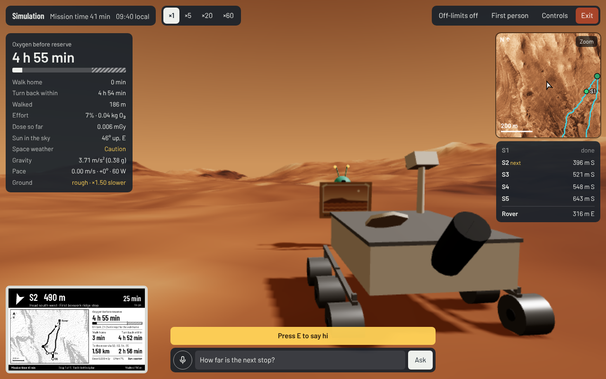
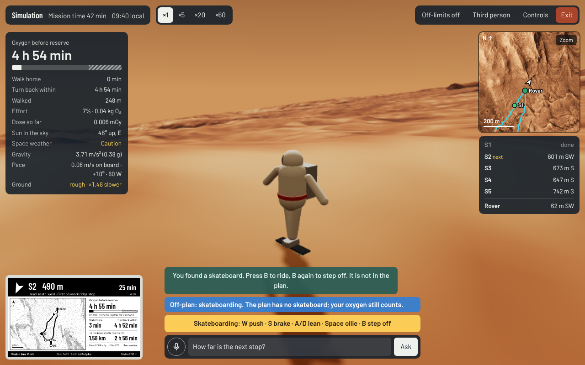

# MarsWalk TODO

The working list for what comes next. Three parts: making the models more like Mars, making the game engine faster,
and the two easter eggs. Every item says why it matters, how to do it (data, formula, files), and how we will know it
is done.

**Status marks.** `[x]` built and checked (the check is named). `[~]` closed without building: measured, and not
needed, or superseded (the numbers are given). `[ ]` open, with what blocks it (usually a dataset).

Rules that every item keeps:

- **One model, two places.** A change to how walking, oxygen or terrain works goes into the planner first
  (`src/marswalk/cost/physics.py` and friends), then into the simulator's copy (`frontend/src/sim/physics.ts`), and the
  parity check is rerun: `pytest tests/test_physics_parity.py` runs the TypeScript in Node against the Python on
  ~2 400 steps, and the in-browser QA (`?qa=1`, below) checks the engine against the same model on the real 1 m grid.
  The simulator never gets physics of its own.
- **Numbers come from data or are labelled as assumptions** in `configs/`, with the source next to them.
- **Every new number gets a check** in `marswalk audit` or in the tests.
- **A model change that moves the plan's headline numbers is opt-in** until someone decides to switch it on; the
  audit then reports the assumption as a finding (⚠️), not a failure.

Priority: **P1** changes what a crew would decide; **P2** makes the numbers more trustworthy; **P3** makes it feel
more like Mars.

---

## 1. Realism: the models

### Done before this round

- [x] **The simulator walks on the planner's own model** (1 m walk surface, roughness, sand, off-limits; speed,
  terrain multiplier and power step for step; grades over 20° cannot be walked).
- [x] **The real Sun** (Mars24, Allison & McEwen 2000, `src/marswalk/sun.py`, both NASA GISS worked examples to 0.001°).

### P1: changes what a crew would decide

- [x] **Walking at 0.38 g: the gait limit.** Kram, Domingo & Ferris 1997 (J. Exp. Biol. 200: 821, Table 1): at 0.4 g
  people switch from walking to running at 1.39 ± 0.06 m/s (Froude 0.56, leg 0.89 m, unsuited). `walk_run_froude` and
  `leg_length_m` in `configs/eva` cap walking speed at √(Fr g L) = 1.36 m/s, in the planner, the safe zone and the
  simulator alike (parity test covers the cap on and off). **Off by default**: on, this plan goes from 3.52 h to 3.54 h
  outside and its smallest walk-home margin from 124.8 to 123.5 min. The audit compares the model's top speed with
  Kram's measurement as a finding (1.6 vs 1.39 m/s ⚠️ while off). No loping model: above the cap the crew walks.
  - Open part: a loping energy model for suited walkers above the transition (needs suited reduced-gravity data).
- [ ] **Metabolic cost measured at Mars gravity.** Still Santee's Earth formula with the level term scaled by g/g_Earth
  (a labelled assumption). Blocked on data: suited metabolic rates at 0.38 g (parabolic-flight or partial-gravity
  treadmill studies) to calibrate against; keep today's model selectable when it lands.
- [x] **The consumable that runs out first.** `src/marswalk/consumables.py` tracks oxygen (time) and effort (energy)
  always, and cooling water (2 454 kJ evaporated per kg), CO₂ scrubbing (O₂ burned × RQ 0.82 × 1.977 g/L) and battery
  (fixed draw) once `[consumables]` in `configs/eva` gives their capacities. The plan summary names the limiting one
  ("Runs out first: oxygen"); the suit display's top readout is the first to run out at the current rate and drives
  "turn back within". Tests: `tests/test_exposure.py` (0.44 kg/h of water at 300 W; a small tank takes over the limit).
  - Open part: capacities from a real suit specification (xEMU or successor); none are set, because none were found
    that could be cited.
- [x] **Radio shadow.** `src/marswalk/layers/radio.py`: line of sight from the rover's antenna to a suit antenna over
  the terrain (numba ray sweep, 0.3 s; Mars curvature included; antenna heights 3 m and 2 m are assumptions in
  `[comms]`). Map view "Radio", plan summary and a caution ("18 min out of radio contact, longest stretch 12 min"),
  simulator status line, radio static/chirp, debrief row. Audit: the sweep agrees with a direct line of sight at 199 of
  200 random cells. Finding: from this rover spot 88 % of the walk range has no line of sight to a 3 m mast.
- [x] **Shelter time for a solar storm.** Warning lead `sep_warning_lead_min = 30` from Löwe et al. 2025 (Space
  Weather, doi:10.1029/2025SW004372: RAD-based nowcasting gave at least 30 min to avoid the peak and 90 % of the dose of
  every SEP event at Gale since 2012). Map view "Storm shelter" marks ground whose walk home (× margin) is longer;
  plan summary, caution, simulator status line. Audit: the longest walk home on this route is 15 min, inside the 30.

### P2: makes the numbers more trustworthy

- [x] **Uncertainty in the terrain.** `src/marswalk/layers/uncertainty.py`: 20 draws of correlated noise (σ = 0.3 m,
  an assumption: this DTM's own precision is not in its label or README; HiRISE gives "tens of cm" for 1 m DTMs,
  Sutton et al. 2022) plus sub-metre registration shifts; the stack's own slope, roughness and hazard limits on each.
  Map view "Certainty" (amber: off limits in some draws only; red: in nearly all), plan summary and caution, two audit
  checks (route on always-off-limits ground: 0 m; on sometimes-off-limits ground: 50 m of 1 709 m). 1.9 s over the
  walk area. Sensitivity: at σ = 0.5 m the "sometimes" share goes from 17 % to 55 % and the route's from 50 m to 659 m.
  Adding noise to a DTM that already has its own makes 1 m slopes read a little steeper, so "sometimes" leans cautious.
  - Open part: route on the "sometimes" class with a penalty (needs the uncertainty grid inside the compiled cost
    kernel; today the route is reported, not steered).
- [ ] **Sand that is more than yes/no.** Blocked twice: there is no loose sand on this site at THEMIS resolution
  (thermal inertia is 317 or more; the threshold is 300), so a continuous model would change nothing here; and
  boot-on-regolith sinkage and slip (Bekker–Wong parameters for a boot, not a wheel) are not published.
- [ ] **Rocks you can count.** Needs the 462 MB 25 cm orthophoto (`ortho_25cm`) and a validated shadow-based boulder
  detector. Unblocks E6.
- [ ] **Dust in the air.** Needs Mastcam optical-depth records for Gale (PDS Atmospheres node) by season.
- [ ] **Temperature.** Needs REMS records or the Mars Climate Database by Ls and local time; feeds the cooling-water
  consumable above.
- [ ] **Radiation that changes.** Needs the published RAD dose-rate dependence on surface pressure and solar cycle.
- [ ] **Validation against people.** Needs BASALT / Desert RATS timelines to tune `time_margin_factor`.

### P3: makes it feel more like Mars

- [ ] **True colour.** Needs the HiRISE IRB strip (S2 only) and Mastcam colour calibration.
- [x] **Sound.** `frontend/src/sim/audio.ts` (synthesized, no recordings; "Sound" button, off by default): footsteps
  through the suit, unchanged; the rover's idle through the air, 1/d quieter, low-passed where Martian air has absorbed
  20 dB (Perseverance's measured 0.21 / 0.34 / 0.43 per metre at 3–6 / 6–11 / 11–15 kHz, Maurice et al. 2022, Nature
  605: 653; extrapolated below 2 kHz) and delayed at 240 m/s; radio static when contact is lost, a chirp when it is
  back. Test: `tests/test_sim_audio.py` (6.9 kHz survives 8 m, 1.6 kHz survives 30 m).
- [ ] **Wind and dust devils.** Needs REMS wind and dust-devil counts at Gale by season.
- [x] **Mission clock.** `sun.mars_sol_date` (Mars24 C-2, tested against GISS example 1: MSD 44 795.99976) and local
  true solar time: the suit display's footer ("Sol 54344 · 09:41 local") and the simulator's top bar.
- [x] **Local gravity.** Closed with a number: free-air 2Δh/R over the route's relief plus the Clairaut latitude term
  give a 0.003 % change across the walk (audit check, limit 0.1 %). Mass anomalies (GMM-3, ~90 km resolution) barely
  vary across a 4 km site. One g for the whole walk.

---

## 2. The game engine

### Done before this round

- [x] Terrain in tiles with frustum culling; adaptive resolution; shadows only when something moved; no garbage per
  frame; the 1 m grid kept 16-bit; engine statistics (F); the simulator as its own bundle.

### Done this round (QA: `?qa=1`, 25 checks, all pass on the real terrain)

- [x] **QA in the repo.** `frontend/src/sim/qa.ts`: open the app with `?qa=1`, plan, press Simulation. It drives the
  engine in fixed ticks and checks it against the planner's models: every engine step equals the planner's priced edge
  on 1 110 cells of the real 1 m grid (largest difference 4e-16), speed and power while walking, the 20° limit, the
  Sun, 30 min of work = 450 kJ, the hop, off-limits time, radio, fixed ticks, the eggs, sleep when paused, shadow and
  HUD redraws, the 1 m patch, triangles and frame rate. Results print to the console and stay on `window.__simQA`.
- [x] **E1. Level of detail for the ground.** Within 80 m of the walker the 1 m terrain itself is drawn (rebuilt every
  16 m, ~3 ms; its outer 8 m blend into the 3 m mesh: no step at the edge, 6 mm at most); the 3 m tiles skip their
  pixels under it (a moving hole in the shader) and drop to 6 m beyond 350 m and 12 m beyond 800 m, with skirts. The
  boots, camera and lines follow the ground as drawn. Triangles: 176 k drawn, down from 258 k with 3 m everywhere.
- [~] **E2. A Web Worker.** Measured on the main thread: building all ground tiles 7.7 ms, placing the egg 7.3 ms, the
  1 m grid decode zero-copy. Under two frames at start: not worth a worker.
- [x] **E3. Binary heights.** `GET /api/sim/terrain.bin` (gzip) instead of base64 in JSON. Binary URLs carry a format
  version and the data stamp, so a browser never decodes a stale copy (that bug was hit once, and is why).
- [ ] **E4. Compressed textures.** Needs a Basis Universal encoder in the pipeline (none in Python's ecosystem worth
  depending on); the photo is ~22 MB on the GPU today, fine for laptops.
- [x] **E5. Lighting detail from 1 m normals.** A tangent-space normal map of the 1 m terrain on the 3 m mesh, key
  **N**, built on first use (65 ms), gentle strength 0.6, **off by default**. Measured: with the Sun 37° up (09:00), it
  changes 1.6 % of far-ground pixels visibly, because the HiRISE photo carries its own shading. Judge it by eye at a
  low Sun before turning it on by default. Near the walker E1 draws real 1 m geometry instead.
- [ ] **E6. Instanced rocks.** Waits on "Rocks you can count".
- [~] **E7. Cascaded shadow maps.** Over the planned walk the Sun is 37° to 74° up, so shadows are at most 1.3 times an
  object's height and fit the 80 m shadow box; cascades matter only near sunset, outside the plan.
- [x] **E8. Fixed time step.** The simulation runs in fixed 1/60 s ticks with an accumulator; the walker, camera, light
  and board are drawn between the last two ticks. QA: one 5 s step and 25 small ones end at exactly the same place.
- [x] **E9. A lighter HUD.** The engine hands the HUD a snapshot (via `useSyncExternalStore`) only when something
  changed at the precision it is shown; the minimap redraws only when the walker moved a pixel or turned a degree.
  QA: standing still, 1 HUD update a second (the stats line) and 0 minimap redraws; walking, 6.4 updates a second.
- [x] **E10. Sleep when nothing changes.** Paused, finished or out of oxygen, the loop draws once more and stops; any
  key, drag, resize or setting wakes it. QA checks both.
- [x] **E11. Real-GPU numbers.** This Mac (Cursor's browser, 120 Hz display): 120–144 fps, 7–8 ms a frame, 176 k
  triangles, 26–31 of 48 tiles drawn, resolution adapting up to ×2. Reproduce with `?qa=1` (last check).
- [~] **E12. WebGPU.** Not needed at 7–8 ms a frame; would first need the sky shader and the route lines (Line2) ported
  to three.js node materials.

---

## 3. Easter eggs

Both are off-plan: they never change the plan, oxygen keeps counting, and the debrief says when they were used.

### [x] Perseverance and the cardboard Mars

Somewhere off the route, Perseverance (officially near Jezero crater, about 3,800 km from Gale) has its mast camera
trained on a cardboard picture of Mars. An alien is holding it up for the photo.

- **Where:** `WalkGrid.findQuietSpot()` picks the flattest walkable ground 150 to 320 m from the rover and at least
  90 m from every stop and the route. The same terrain always gives the same spot. No map marker: you find it by
  looking around (the alien's antennae glow).
- **What happens:** within 30 m the alien peeks over the sign and turns its head to follow you. Within 12 m, **E** says
  hi: it lowers the sign and waves. It counts in the debrief ("Easter eggs found").
- **Models** (`frontend/src/sim/eggs.ts`): Perseverance from simple shapes at its real size (about 3 m long, six
  52.5 cm wheels, rocker-bogie, RTG at the back, mast head with SuperCam and the Mastcam-Z pair, folded arm). The mast
  head is aimed at the sign with `lookAt`; QA checks it points within 2° (0.00° on the real terrain). The alien is our
  own design (teal, three eyes, two glowing antennae). The picture is drawn in code on a canvas: sky, Sun, a mesa,
  dunes, tape, and "MARS (real)" in marker.
- **Ideas:** the rover's camera view on a little screen (render-to-texture from the mast head); a photo mode.

### [x] Skateboarding on Mars

A skateboard lies a few steps to the right of the crew rover. **E** picks it up, **B** gets on and off.

- **Controls on the board:** W push, S brake (foot drag), mouse or A/D steer, Space ollie (the same hop physics:
  0.86 s in the air at 3.71 m/s²), B step off.
- **Physics** (`frontend/src/sim/skate.ts`, all per 0.5 s or finer slice of mission time, on the planner's 1 m ground):
  - downhill pull: g sin(grade), g = 3.71 m/s² (a 10° slope gives 0.50 m/s² after rolling resistance; checked)
  - rolling resistance: C_rr × g cos(grade), with C_rr = 0.04 on smooth firm ground, + 0.08 per metre of the planner's
    roughness, + 0.25 on loose sand (assumptions for small urethane wheels on regolith; capped at 0.8). The roughness
    term used to be 0.3 per metre, which cancelled a downhill on this ground.
  - air drag: ½ ρ C_d A v² with ρ = 0.02 kg/m³: 0.2 N at 5 m/s against 21 N of rolling resistance. On Mars the air
    does nothing; the ground does everything.
  - kicking: the back foot is on the ground for the same slice of the push the animation draws (0.18 to 0.55 of
    each 1.1 s push, 0.41 s). That contact pushes at min(μ × weight, P / v) with μ = 0.6 (the same boot friction
    as the brake) and P = 900 W while the foot is down, fading to nothing by 6.2 m/s so kicking alone stays under
    the wobble. Uphill, the foot also pushes an extra 1.5 times the slope's pull, because Mars weight is too small
    for the boot to grip a real climbing shove. Between kicks the board only coasts. One kick from a stop on smooth
    ground adds about 0.85 m/s.
  - braking: 1.5 m/s² (friction-limited: 0.6 × 3.71 = 2.2 at best)
  - what you get: kicking settles near 6 m/s on smooth ground and on the ground here (under the 7 m/s wobble; a
    downhill can still push you over it). On sand a kick shoves the board and the sand stops it before the next
    kick, so it never holds a speed. An 8° hill is climbable. A 10° downhill coasts at about 0.50 m/s² with no
    kick at all. Coasting from 3 m/s on the flat lasts about 20 s.
  - wipeouts: speed wobbles over 7 m/s, or rocky (off-limits) ground at over 1.2 m/s. You come off the board.
- **Accounting:** time, oxygen and energy keep counting (the push costs real effort); distance on the board is logged
  separately and shown in the debrief as off-plan. A blue banner says you are off-plan while riding.
- **Ideas:** trick scoring for ollies off ledges (airtime is long at 0.38 g); a downhill run timer from the top of the
  boxwork ridge; dust plume from the wheels.

### How to add another egg

1. Model in `eggs.ts` (own design only: no characters or logos from anywhere else).
2. Place it in `SimEngine.placeEggs()` with a deterministic rule on the walking grid.
3. Reach and prompt in `checkEggs()`, action in `act()`, animation in `animateEggs()`.
4. Count it in `status.eggsFound` (and the "of N" in the debrief), and add a check in `frontend/src/sim/qa.ts`.
