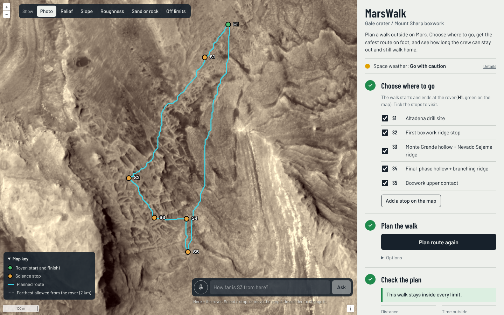

# MarsWalk wiki

MarsWalk plans a walk outside on Mars: where to go, the safest way there on foot, and, above all, how long the crew
can stay out and still walk home.

| Page | What is in it |
|---|---|
| [How it works](How-it-works.md) | The pipeline from NASA archives to the screen |
| [Data sources](Data-sources.md) | Every dataset, its resolution, and facts checked against the files |
| [Models and math](Models-and-math.md) | Every formula behind every number, with sources |
| [Audit](Audit.md) · [results](Audit-results.md) | How the numbers were checked, and the four errors it caught |
| [Voice questions](Voice-questions.md) | Ask MarsWalk out loud |
| [Suit display](Suit-display.md) | The e-ink navigation screen and its ESP32 firmware |
| [API](API.md) | Endpoints |
| [Running it](Running.md) | Setup and troubleshooting |
| [Decisions](Decisions.md) | What was chosen over what, and why, by component |
| [Knowledge graph](Knowledge-graph.md) | A map of the code itself |

To publish these as the GitHub wiki: `git clone <repo>.wiki.git`, copy `docs/wiki/*.md` into it and `docs/img/`
next to them, change `../img/` to `img/`, and push.
