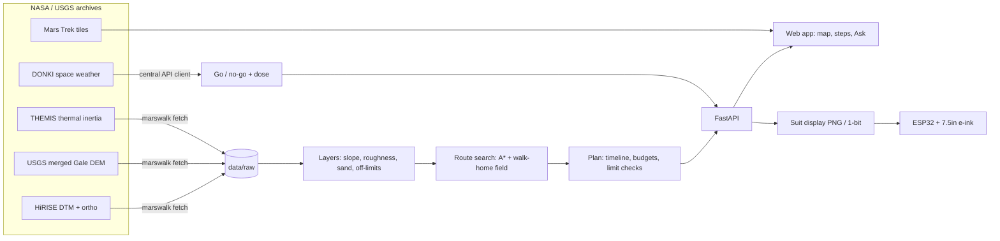

# How it works

1. **Fetch.** Read just the window around the rover from each archive and cache it.
2. **Register.** Move the HiRISE DTM onto the base map (it is 45 m off), then measure what is left.
3. **Layers.** Slope at 1 m and 5 m, roughness, sand from thermal inertia. Mark *off-limits* where any limit is broken
   or no trusted 1 m terrain exists.
4. **Search.** A* finds the cheapest walk between stops on the 1 m grid. Cost is metabolic energy, or a weighted
   time/slope/roughness score. One reverse Dijkstra from the rover gives the walk home from every cell.
5. **Plan.** Order the stops (fixed or optimised), build the timeline with a 30 % time margin, add up time, energy and
   oxygen, and check every limit at every point of the route, including whether the crew can still walk home.
6. **Space weather.** Ask DONKI for CME arrivals predicted at Mars, particle events and flares. Turn them into
   GO / CAUTION / NO-GO and add the RAD dose for the walk.
7. **Show it.** A web app (React + OpenLayers on a Mars map projection), voice questions, and an e-ink suit display.

## Where things live

| Folder | What |
|---|---|
| `src/marswalk/sources` | Fetching archives, the central NASA API client, the HiRISE DTM catalog, global photo tiles |
| `src/marswalk/layers` | Terrain layers, registration and coverage, overlay rendering |
| `src/marswalk/cost` | Walking speed and metabolic models |
| `src/marswalk/route` | Compiled A*/Dijkstra, plan building, stop ordering |
| `src/marswalk/spaceweather` | DONKI go/no-go, radiation (measured at Gale, estimated elsewhere) |
| `src/marswalk/bases` | Saved Bases, focus, the job that makes a new one |
| `src/marswalk/ask.py`, `eink.py`, `audit.py` | Voice answers, suit display, audit |
| `src/marswalk/api` | FastAPI app |
| `frontend/src` | The web app (fetch calls only in `api/`; enforced by ESLint) |
| `firmware/suit_display` | ESP32 sketch for the e-ink panel |
| `configs/` | Site and EVA limits: every threshold lives here, not in code. `configs/preview/` holds the stored Gale route the database loads when it has no plans |
| `data/` | Downloads (`raw/`), caches (`cache/`), your Bases (`bases/`) and `marswalk.db`; none of it in git. A hosted function uses `/tmp/marswalk` for the same files |
