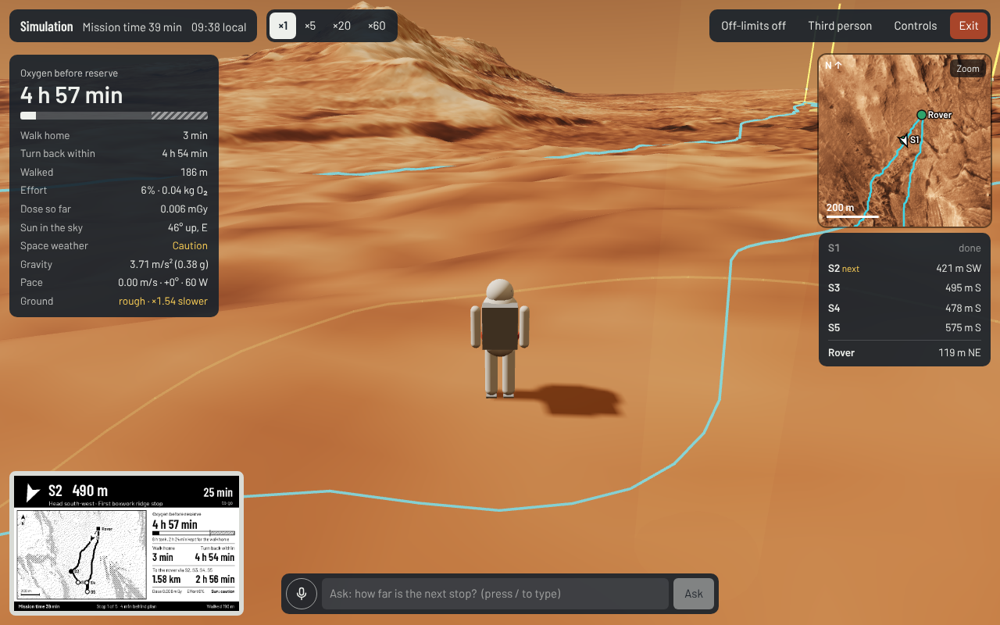
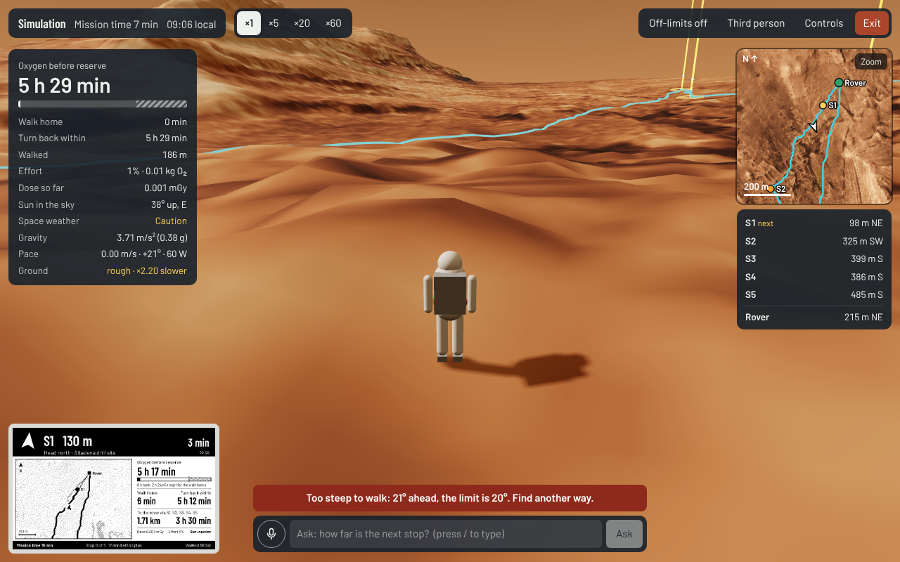
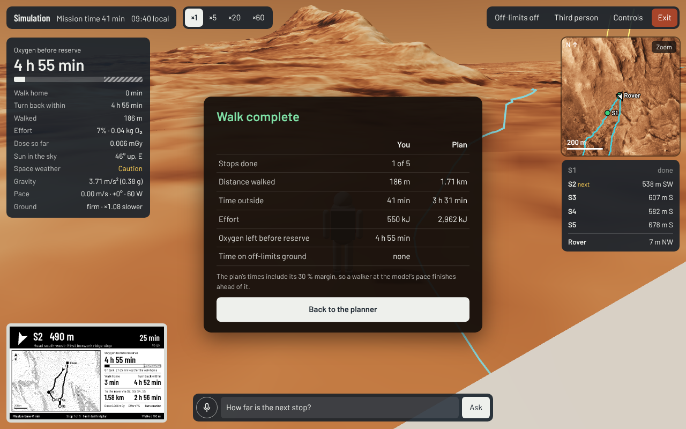

# Simulation

A plan on a map is a promise. The simulator lets a crew member keep it with their own hands first: walk the planned
route, on the real ground at Gale crater, under Mars gravity, while the suit's oxygen drains at the rate the planner
predicted. Plan a route, then press **Simulation** in the header. The simulator walks the route on screen; without
one you can still explore the ground, but there is no route line, suit display or debrief comparison.

## What is on the screen

| Where | What it shows |
|---|---|
| Top left | Mission time, local solar time at the rover, and the time speed (×1, ×5, ×20, ×60) |
| Left | **Status report**: oxygen before the reserve, walk home, turn back within, distance walked, effort and oxygen breathed, radiation dose so far, where the Sun is in the sky, space weather, gravity, pace (speed, grade, power) and the ground under your boots with how much it slows you |
| Top right | **Minimap**, north up, on the HiRISE photo: route, stops, rover and you |
| Right | **How far is everything**: each stop and the rover, with distance and compass direction; the next stop is marked, finished stops say "done" |
| Bottom left | **The suit display**, the same e-ink screen the ESP32 shows, redrawn from your live position once per minute of mission time (the ESP32 downloads it once a minute) and whenever you finish a stop. Click it to enlarge |
| Bottom | **Ask**: type or press the microphone. Answers use where you are standing and which stops you have done |

## Controls

| Key | Action |
|---|---|
| Mouse | Look and turn (click the scene to take the mouse) |
| W / S | Walk forward / back (backwards at half speed) |
| A / D | Step sideways (half speed) |
| ← / → | Turn without the mouse |
| Space | Hop |
| E | Work at a stop (inside its amber ring), or end the walk at the rover |
| T | Time speed ×1, ×5, ×20, ×60 |
| V | First or third person |
| H | Show off-limits ground |
| M | Minimap zoom |
| / | Ask a question (or use the microphone) |
| Drag · wheel | Look around · zoom |
| Esc, Controls, ? | Pause, and show the key list. The list used to be its own card and sat on top of pause |
| F | Engine statistics: fps, draw calls, triangles, ground tiles in view, resolution, shadow redraws |
| N | 1 m relief in the light on the far ground (off by default: the photo already carries its own shading) |
| Sound (button) | Footsteps, the rover through the thin air, the radio (off by default) |
| B | Ride the skateboard, or step off (once you have picked it up with E) |

## What is real

The walk has no physics of its own. It runs the planner's models on the planner's data, step for step, so what you
feel on foot is what the plan assumed. The skateboard, under [Easter eggs](#easter-eggs), is the exception.

- **The ground under your boots.** The physics reads the planner's own 1 m grid: the walking surface the route search
  takes its grades from, roughness, loose sand (from THEMIS thermal inertia) and the off-limits mask, cell for cell
  (`GET /api/sim/fine.bin`). A test checks that each stop's cell holds the same values as the route search's layers.
- **Your speed.** Every half second of mission time, the engine reads the grade one metre ahead along your heading on
  that walking surface and sets your speed from the planner's speed-versus-slope curve (1.6 m/s on the flat at most).
  Rough ground stretches the time by 1 + 2 × roughness in metres, loose sand by another ×1.2, exactly as the route
  search prices a step. The speed applies along the slope, so a climb also covers less ground on the map. You cannot
  outrun the plan by holding W.
- **The 20° limit.** A grade the planner will not route over cannot be walked: you stop, and the screen says how steep
  it is and that you need another way.

  

- **Your oxygen.** Power comes from the same metabolic model as the planner (Santee, scaled to Mars gravity), at the
  same crew and suit mass, taken at the model speed while the terrain multiplier stretches the time, which is how the
  planner charges rough ground. Standing still costs resting power (60 W); working at a stop costs 250 W; a hop costs
  the energy of lifting you and the suit, at 25 % muscle efficiency. The oxygen gauge counts down the 8-hour tank minus
  the 30 % reserve, in mission time.
- **Gravity.** 3.71 m/s², 38 % of Earth's 9.81. A hop at 1.6 m/s takes 2v/g = 0.86 s and rises v²/2g = 0.35 m, and
  the QA run measures exactly that. It feels harder than Earth when you push something, because grip is friction
  times weight, and the weight is smaller. The hill pulls less too. The sluggish part is the push.
- **The route on the ground.** Cyan is the way out, orange the way back to the rover. Ask "go to S3" from where you
  stand and those two lines are replaced at once: cyan from your feet to S3, orange from S3 home. Go follows the
  cyan line, walking or riding. Steer or brake and you stop following it.
- **The Sun.** The light comes from where the Sun really will be at the rover. The walk starts at the next 09:00 local
  mean solar time (`start_lmst_h` in `configs/eva`), and NASA GISS's Mars24 algorithm (Allison & McEwen 2000) gives the
  Sun's azimuth and elevation every 2 minutes from there. The code reproduces both of NASA's published worked examples
  to within 0.001°. Shadows fall the right way, the Sun climbs toward local noon, and a low Sun turns the sky around it
  blue, as Martian sunsets do. The screen shows the local time and the Sun's height and direction.
- **The walk home.** The status report asks the API the same question as the planner's safe zone: from here, with
  the time used so far, how long is the walk home, and how long can you keep going before you must turn back.
- **Space weather.** The same DONKI go/no-go as the planner, and the dose from Curiosity's RAD rate at Gale.
- **Storm shelter.** The status report says whether the rover is within the 30 min warning a crew gets before a solar
  particle storm's dose arrives (Löwe et al. 2025), from the same walk-home answer.
- **Radio.** The planner's radio-shadow layer comes with the 1 m grid: the status report says when a ridge stands
  between you and the rover's antenna, and counts the minutes out of contact for the debrief.
- **The clock.** The top bar shows the sol (Mars Sol Date at the rover) and local true solar time, the Sun's own clock.
- **The ground you see near you is the ground you walk on.** Within 80 m the real 1 m terrain is drawn, and it follows
  you; farther out the 3 m mesh, coarser still in the distance.
- **Sound** (button, off by default). Your footsteps reach you through the suit. The rover's idle reaches you through
  air of 0.6 % Earth's pressure: quieter with distance, duller (Perseverance measured high pitches absorbed at 0.21
  to 0.43 per metre between 3 and 15 kHz) and late, at 240 m/s (Maurice et al. 2022, Nature). The radio crackles when
  contact is lost and chirps when it is back. All synthesized; nothing is a recording.

## What is not

- **Far away, what you see is smoother than what you walk on.** Beyond 80 m the mesh averages heights into 3 m blocks
  (6 m and 12 m in the distance) so a laptop can draw it. The physics always uses the full 1 m grid.
- **The colours are not true colour.** HiRISE photographs this area in one red band; the simulator tints it to Mars
  colours. The sky colours are an artist's choice, not a radiative model.
- **No weather.** No dust storms, wind or temperature. The planner has no model of them either.
- **The suit is a figure, not a suit model.** No joint limits, fatigue or falls. Walking backwards at half speed is
  the simulator's own choice; the planner never plans a backwards step.
- **Off-limits ground warns, it does not stop you.** Time spent on it is logged and shown in the debrief. Grades over
  20° do stop you.
- **Measured best at Gale.** At a [Base](Bases.md) the simulator walks that Base's own terrain and photo, but its
  radiation rate is an estimate and its alignment was measured automatically, not by hand.

## The debrief

End the walk at the rover with E, or run the tank dry, and the debrief compares you with the plan: stops done,
distance, time outside, effort, oxygen left before the reserve, time on off-limits ground (walking, standing or
working on it) and time out of radio contact. It ends one of three
ways: *Walk complete*, *Back, but into the reserve*, or *Out of oxygen*.

## How it was checked

Two checks, both in the repository, both rerunnable.

**The physics, Python against TypeScript** (`pytest tests/test_physics_parity.py`): Node runs `physics.ts` itself
against `cost/physics.py` on about 2,400 steps (grades from −25° to +25°, straight and diagonal, three roughness
levels, sand or not, gait limit on and off), and walking speed and power on their own. Every number agrees to 1e-12;
the test was checked by changing one coefficient by one digit, which it catches.

**The game, in the browser** (`frontend/src/sim/qa.ts`): open the app with `?qa=1`, plan the route, press Simulation.
It drives the engine in fixed ticks and checks it against the models; results print to the console and stay on
`window.__simQA`. From the last run on the real terrain (2026-11-15, 25 of 25 pass):

| Check | Result |
|---|---|
| Every engine step against the planner's priced edge, 1,110 cells of the real 1 m grid | Identical (largest relative difference 4e-16); ground ×1.04 to ×2.48 slower |
| Walking 402 s of mission time toward S1 | 143 m at 0.36 m/s average, never above 1.24 m/s (limit 1.6) |
| Average power while walking | 177 W, inside the model's 60–450 W |
| A 21°+ grade on the walking surface | Stopped: 0.000 m moved, "too steep" |
| The Sun at the start / 3 h later | 36.7° up at azimuth 74.5° / 73.8° up |
| 30 min of work at S1 at 250 W (450 kJ expected) | 450 kJ over 30.0 min |
| Hop under 3.71 m/s² (0.863 s expected) | 0.850 s (one 1/60 s tick) |
| Standing on off-limits ground | Flagged and timed |
| Radio | No contact in the planner's shadow, contact outside it |
| Fixed ticks: one 5 s step against 25 small ones | 0.000 m apart |
| Perseverance's mast on the cardboard Mars / the alien from the nearest stop | 0.00° off / 249 m away |
| Paused: the render loop sleeps; resumed: it wakes | Yes, yes |
| Standing still: HUD updates, minimap redraws, shadow redraws | 1 a second (the F stats line), 0, 0 |
| Walking: HUD updates, minimap redraws, shadow redraws | 6.4 a second, 10 in 2 s at ×20, 60 a second |
| Under the walker the ground drawn is the 1 m terrain / step at the patch edge | 0 m / 6 mm at most |
| Walking 40 m rebuilds the 1 m patch | Yes |
| Ground tiles drawn / triangles | 26 to 31 of 48 / 176 k (258 k before the 1 m patch and the coarser far tiles) |
| Frame rate on this machine (Mac, Cursor's browser, 120 Hz display) | 120–144 fps, 7–8 ms a frame |

The sand multiplier is tested but never comes into play on this walk: THEMIS thermal inertia in this window never
drops below 317, and MarsWalk calls ground loose sand below 300. The microphone is not tested automatically; the typed
question goes through the same path.

## Easter eggs

There are two. Neither touches the plan; oxygen keeps counting and the debrief says when they were used. Where they
are is in [`TODO.md`](../../TODO.md#3-easter-eggs).

The skateboard is the one with its own mechanics. A kick fires when the back foot meets the ground, the same moment
the animation draws, and then the board coasts. The hardest grip-legal kick is 0.6 times Mars weight, so each shove
is about 38 % of the speed the same boot would add on Earth. Uphill, the foot pushes an extra 1.5 times the slope's
pull, only while climbing, because that legal kick was stalling on the grades around the rover. Kicks fade out by
6.2 m/s so pushing alone stays under the 7 m/s wobble; a downhill can still throw you. Rolling resistance adds 0.08
per metre of the planner's roughness (it was 0.3, which cancelled a downhill on this ground). Sand still stops it.
The numbers and the check are in `frontend/src/sim/skate.ts` and `tests/test_skate.py`.

## Under the hood

- `GET /api/sim/terrain?step=3` returns the local frame (east and south metres from the rover), the 1 m grid's
  frame, the physics constants from `configs/`, and the URLs of the two binary grids below. Those URLs carry a format
  version and the data stamp, so a browser never decodes a cached copy in an older layout.
- `GET /api/sim/terrain.bin?step=3&v=…` returns the 3 m mesh (gzip): heights in 16-bit centimetres, then off-limits bits.
- `GET /api/sim/texture.png?kind=photo|hazard` returns the ground photo or the off-limits overlay, on the same grid.
- `GET /api/sim/fine.bin?v=…` returns the 1 m grid (gzip): walk-surface heights, terrain heights (both 16-bit
  centimetres from one zero), roughness, then sand, off-limits and radio-shadow bits.
- `GET /api/sim/sun?start_utc=&hours=` returns the Sun's azimuth and elevation through the walk (`src/marswalk/sun.py`,
  Mars24, tested against NASA's worked examples in `tests/test_sun.py`).
- `/api/eink.png` and `/api/ask` accept the live position (`lat`, `lon`, or `here_lat`, `here_lon`), the distance
  walked, the energy used and the stops done.
- On a machine that has run `marswalk fetch`, those routes build the mesh from `dtm.tif`. On the hosted site
  that file is not in the deploy, and downloading it inside the request gets cut off, so `/api/sim/terrain`
  answers **409**. The Gale page then loads the mesh shipped with the site, `frontend/public/sim/gale/`
  (`terrain.bin`, `fine.bin`, `photo.png`, `hazard.png`), the same H1 and S1–S5 window.
- The frontend code is in `frontend/src/sim/`: `terrain.ts` (the 3 m mesh at three levels of detail, the 1 m walking
  grid and the 1 m patch drawn around you), `physics.ts` (the speed, power and terrain models, identical to the Python),
  `astronaut.ts`, `eggs.ts`, `skate.ts`, `audio.ts`, `engine.ts` (Three.js scene and the fixed-tick mission-time loop),
  `qa.ts` (the checks above) and `SimulationView.tsx` (the heads-up display). The simulator loads only when you open
  it, so it adds nothing to the planner's start-up.
