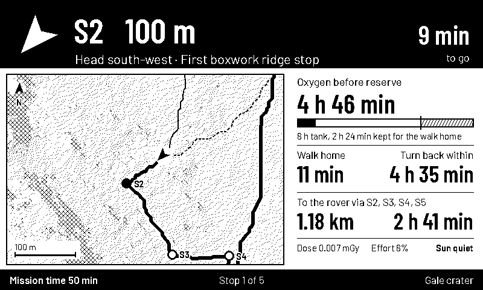
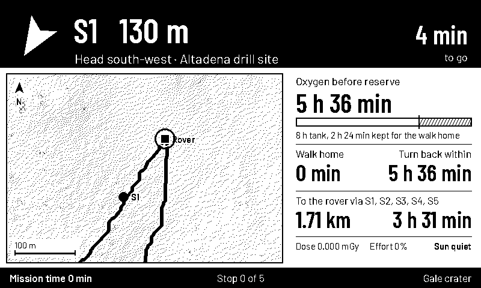
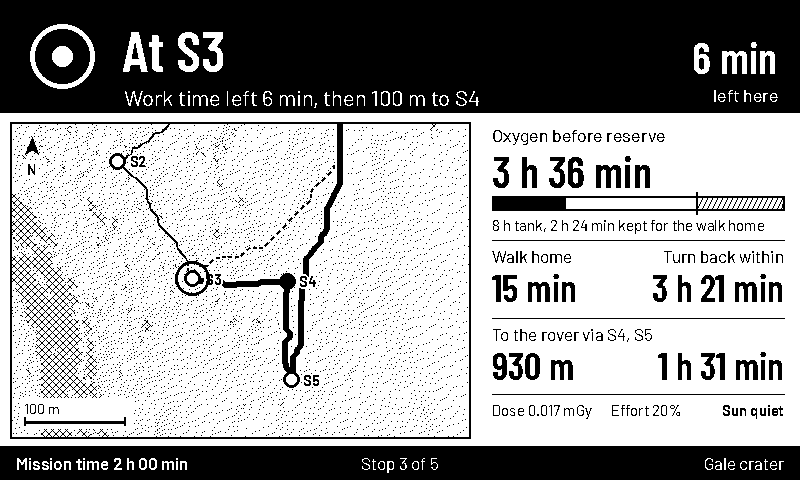
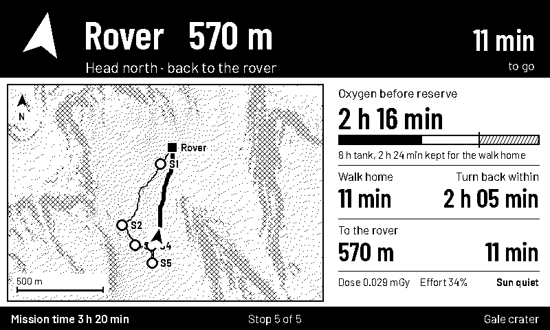

# The suit display (e-ink)

Car navigation answers three questions without you asking: where do I turn, how far, and when do I get there. On a
Mars walk the questions are sharper: how far to the next stop, **how much oxygen is left**, and **when must I turn
back**. The suit display answers them on a 7.5-inch e-ink panel. E-ink is readable in full sun, uses no power between
updates and survives cold.



## What it shows

- **Banner:** the next stop, the distance along the route and the time to get there, with an arrow pointing the way.
  While you work at a stop it shows the work time left instead.
- **Map:** north-up, scaled to show you and the next stop. Bold line: the route ahead. Thin line: the route walked.
  Dashed line: the walk home from where you stand. Cross-hatching: off-limits ground. Faint relief: the terrain.
- **Oxygen before reserve,** with a gauge. The hatched end of the bar is the 30 % kept for the walk home.
- **Walk home and turn back within.** The block turns black when less than 30 minutes of slack are left.
- **To the rover:** distance and time remaining, and the stops still to visit.
- **Dose so far, effort used, and the Sun** (space-weather verdict).
- **Footer:** mission time and stop count.

| Leaving the rover | Walking S3 → S4 | Near the end |
|---|---|---|
|  |  |  |

## In the app

Step 5, *Follow it on the suit*, shows the screen for any moment of the plan. Drag the slider or press
**Play the walk**, then click the picture to see it full size.

## On real hardware

`firmware/suit_display/` is an Arduino sketch for the **Waveshare Universal e-Paper Driver Board (ESP32)** with the
**7.5" V2 panel (800 × 480)**. The planner draws the whole screen. The board downloads it once a minute and puts it
on the glass:

```
GET /api/eink.bin?elapsed_h=1.2      48 000 bytes: 1 bit per pixel, rows top to bottom, MSB first, 1 = black
GET /api/eink.png?elapsed_h=1.2      the same screen as a PNG
```

Run the planner with `marswalk serve --host 0.0.0.0`, set Wi-Fi and the planner's address in the sketch, and flash.
Mission time counts from power-on; `TIME_SCALE = 30` replays a 3.5 h walk in 7 minutes for a demo.
