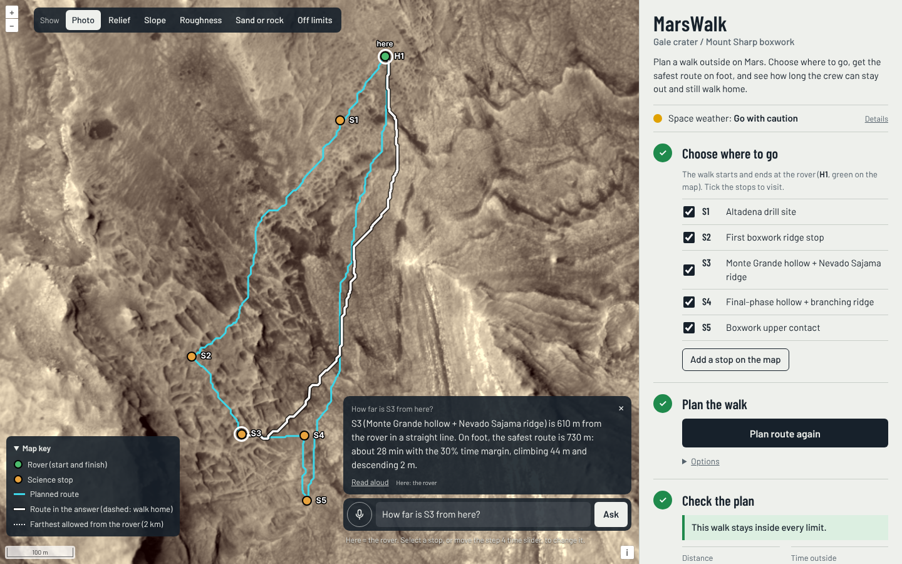

# Ask MarsWalk (voice)

Press the microphone on the map and ask: *"How far is S3 from here?"* MarsWalk answers out loud. It draws the route
it is talking about in white on the map (dashed if it is the walk home).

## What you can ask

| Question | What answers it |
|---|---|
| How far is S3 from here? / distance between S1 and S5 | Straight-line distance, plus the safest walking route: length, time with the margin, climb and descent |
| How long to walk home from S5? / when must we turn back? | Walk-home field from the rover: distance, time, and how long until you must start back |
| How much oxygen? | 8 h tank, 30 % reserve, the share this walk uses, kg breathed, oxygen time left at a stop |
| How much radiation / exposure? | Dose for the walk from Curiosity RAD rates, plus the space-weather verdict |
| How much energy? | kJ and kcal per crew member, share of the effort budget |
| How steep is S2? / is the ground sandy? | Slope, roughness, elevation, walkable or not, thermal inertia |
| What's the next stop? / where do we go? | Order and arrival times |
| Is the plan safe? / is it safe to go out? | Limit checks and the space weather |
| Water, food, battery, temperature... | Says plainly that MarsWalk does not track them yet |

## "Here"

"Here" is the stop selected on the map. With no stop selected, it is where the plan puts you at the time on the
step 4 slider; failing that, the rover. Every answer says which one it used.

## How it understands you

There is no language model and no network call. A small parser (`src/marswalk/ask.py`) finds the topics a question
asks about, and several can be asked in one breath. It also finds the places named:

- stop codes the way speech-to-text spells them: "S3", "s 3", "s three", "stop three", "s-3", even "s for" for S4
- distinctive words of stop names: "Monte Grande", "upper contact"
- "the rover", "home", "here", "the next stop", "the last stop"

Every number then comes from the same code that builds the plan, so an answer can never disagree with the screen.
Tests cover the parser on the real Gale stop names.

Speech-to-text is the browser's own: Chrome sends the audio to Google's speech service and Safari to Apple's. The
reply is read by the browser's text-to-speech, with units spelled out ("milligray", not "mGy"). With no microphone,
type the question.
